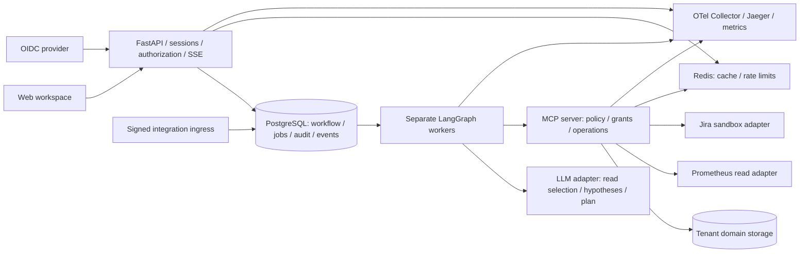

# OpsPilot Full — спецификация и последовательный план реализации

Версия 1.1 · 27 октября 2026 года. План F01–F24; фактические статусы —
в [каноническом tracker Full](docs/full-version-status.md). ASVS L2 включён в критерии этапов.

**AI предлагает; детерминированное ядро контролирует исполнение; человек разрешает запись.**

Этот документ задаёт полную версию поверх существующего продукта, а не переписывание MVP.
Требование владельца: **Portfolio MVP сохранить работающим и неизменным как отдельный продукт**.
Опорный коммит MVP: `01019b6`; перед реализацией проверить его существование и записать полный SHA.
Завершённые MVP-этапы 1–8 остаются завершёнными. F01–F24 — новая независимая нумерация.

## 1. Приоритет документов и сохранение MVP

Для полной версии требования берутся из этого документа. Исходный `OpsPilot_specification.md`
остаётся исторической концепцией; `OpsPilot_Portfolio_MVP_plan.md` и
`docs/implementation-status.md` описывают отдельный Portfolio MVP. При расхождении для Full
действует этот документ; для MVP — его прежний план. Нельзя переносить статус done из MVP в Full.

Обязательная изоляция с F01:

| Ресурс | Существующий MVP | Полная версия |
| --- | --- | --- |
| Checkout | Текущий каталог проекта | Отдельный worktree с отдельным абсолютным путём |
| Git | Сохраняется текущая линия разработки; опорный SHA фиксируется | Ветка `codex/opspilot-full` от planning-коммита с этой спецификацией; application baseline `01019b6` |
| Снимок | Локальный тег `opspilot-portfolio-mvp-v1.0` на опорный SHA | Собственные коммиты F01, F02 и далее |
| Compose project | `opspilot` | `opspilot-full`; тесты `opspilot-full-test` |
| Images | Имеющиеся теги MVP | Только `opspilot-full/*`; сборка не перетегирует образы MVP |
| БД | Существующая `opspilot` и её volume | `opspilot_full`; тестовая `opspilot_full_test`, отдельные volumes |
| Секреты | Имеющийся локальный `.env` | Новый `.env` в Full worktree, независимые случайные секреты |
| Локальные порты | UI 8081, API 8000, Jaeger 16686 | UI 8091, API 8010, Jaeger 16696, dev OIDC 8181, если свободны |
| Media/evals | Прежние файлы и отчёты остаются | Новые артефакты и отчёты в Full worktree |

Перед использованием портов проверить занятость; при конфликте поменять только Full-конфигурацию.
В Full не использовать старый Compose через небезопасное наследование с прежними image/volume names.
Создать автономный `compose.full.yaml`; все именованные ресурсы и команды явно относятся к Full.
Не выполнять миграции, seed/reset, restore, `down -v`, переключение ветки или пересборку образов
в MVP checkout ради реализации Full. Не копировать `.env`, runtime DB, кеш голоса и реальные
credentials MVP. Тестовые команды проверяют и DSN, и фактический `current_database()`.

F01 создаёт игнорируемый локальный указатель `.tools/opspilot-full-workspace.json` в исходном
checkout: `path`, `branch`, `base_commit`, `compose_project`, `status_file`; секретов в нём нет.
Указатель нужен для нахождения Full из этого чата, а не для изменения MVP. Если worktree перенесён,
найти его через инвентарь worktrees и обновить указатель после проверки. При отсутствии инструмента
создания worktree допустим обычный `git worktree`; прежде проверить целевой путь и разрешения.
Существующий тег/ветку с другим содержимым не передвигать и не перезаписывать.
Planning-коммит содержит только новую документацию и README-ссылку; до F01 не менять приложение.
Если Full worktree всё же создан непосредственно от `01019b6`, перенести в его первый коммит
именно эту версию спецификации и planning tracker из проверенного planning SHA. Не начинать
реализацию в worktree без этих документов и не считать отсутствующий tracker разрешением повторить MVP.

## 2. Что считается полной версией

Два обязательных рубежа одного релиза:

1. **Full Core, F01–F17:** несколько пользователей и tenant, проверенные роли, отдельные workers,
   durable jobs, конкурентное восстановление, уточнения, отмена, несколько действий, revisions,
   TTL, свежесть evidence, SSE, полноценный workspace, audit, лимиты и эксплуатационные метрики.
2. **Full Pilot, F18–F24:** изолированные коннекторы, подписанный ingress, реальные чтения
   Prometheus, запись в sandbox Jira Cloud, испытания сбоев/нагрузки, 50 eval cases,
   развёртывание и проверенный backup/restore, итоговая приёмка.

Весь Full считается done только после F24. Работающие mocks и contract tests не заменяют
обязательные live checks F19/F20 или deployment/restore F23.

Это ограниченный production pilot: один регион и одна организация эксплуатации, несколько
tenant и workers, одна PostgreSQL instance с резервным копированием. Multi-region HA,
кластерная СУБД и формальная сертификация не обещаются. Полная версия не означает неограниченный
автономный агент или поддержку всех внешних продуктов.

Вне v1 Full: shell/SQL-tools, удаление клиентов, ротация credentials, рестарт production,
автоматический ремонт, записи без human approval, реальные Salesforce/Shopify/Slack,
платёжные операции, собственная IAM-платформа, fine-tuning, обязательная vector DB,
Kubernetes и multi-region. Notifications в v1 — **внутренний inbox**, не реальная доставка email/Slack.
Дополнительные интеграции требуют отдельной спецификации и приёмки, а не скрытого расширения этапа.

## 3. Пользовательские сценарии

- Оператор входит, выбирает разрешённый tenant, находит клиента и запускает RU/EN расследование.
- При неоднозначности система сохраняет clarification interrupt; выбор переживает restart.
- Агент исследует данные через MCP и показывает текущие факты, гипотезы, историю и missing checks.
- План содержит до трёх явных write-actions: тикет, комментарий к известному тикету,
  внутреннее уведомление конкретному получателю. Каждое действие согласуется отдельно.
- Approver может согласовать часть плана; rejected/expired/dependent actions не исполняются.
- Смена текста, получателя, цели или значимых предусловий требует новой revision и approval.
- После принятия решения worker выполняет допустимые операции и проверяет реальные поля результата.
- Пользователь видит failed/unknown/mismatch отдельно от verified и может отменить оставшуюся работу.
- История, evidence, audit и SSE доступны только в пределах серверных полномочий.
- Администратор подключает Prometheus/Jira к tenant; секреты модели не передаются.
- При недоступном upstream система возвращает честный partial, а не выдумывает здоровый статус.
- Создание тикета не означает восстановления заказов или устранения причины инцидента.

## 4. Роли и доверенная авторизация

Tenant выбирается из membership, проверенного сервером; `tenant_id` из текста, tool arguments
или произвольного заголовка не даёт доступа. Пользователь может иметь membership в нескольких tenant.

| Роль в tenant | Полномочия |
| --- | --- |
| operator | Создать и читать свои runs, отвечать на свои clarification, отменить свой run |
| approver | Читать runs своего tenant и принимать решения по разрешённым действиям |
| auditor | Читать redacted историю и audit своего tenant, без записи и approval |
| admin | Membership/config/connectors tenant; не выдаёт себе обход action-policy |

Для запуска расследования требуется operator; сочетание operator+approver допустимо в demo.
В pilot запрет self-approval включён по умолчанию; demo-исключение явно маркируется и аудируется.
Системный bootstrap admin создаётся отдельной CLI вне публичного API; нет общего tenant `*`.
Потеря роли/отзыв membership до dispatch блокирует ещё не начатую запись, даже с прежним approval.

Вход: OIDC Authorization Code Flow + PKCE, backend-for-frontend и серверные sessions.
Локальный провайдер — отдельный Keycloak в Full Compose; pilot принимает настроенный OIDC issuer.
Проверять issuer, audience, signature, expiry, state/nonce; не подменять OIDC самодельным JWT-login.
Cookie HttpOnly/SameSite/Secure в HTTPS-профиле; CSRF на изменениях, точные redirect/origin allowlists,
logout/revocation, истечение session и отсутствие refresh tokens в browser storage.
Проверки session/membership повторяются для SSE и каждой мутации.
Успешный OIDC login без разрешённого membership не создаёт tenant и не даёт доступа автоматически.
Правило human approval относится к агентным domain writes. Прямые административные изменения
membership/config и пользовательская отметка inbox read требуют своей RBAC/CSRF-проверки и audit,
но не выдаются модели как способы обойти action approval.

## 5. Архитектура и стек

Сохранить текущие Python/FastAPI, настоящий LangGraph StateGraph, официальный MCP SDK,
PostgreSQL/SQLAlchemy/Alembic, React/TypeScript, uv/npm lockfiles и OTel. Не перестраивать
репозиторий в новый monorepo только ради совпадения с историческим деревом.



API не исполняет граф в background task. Worker не имеет domain-write credential и не импортирует
доменные repositories в обход MCP. MCP не получает миграционную роль. OIDC, Redis, MCP,
PostgreSQL и служебные endpoints не публикуются наружу без необходимости.
Redis не является хранилищем jobs, approvals, checkpoints или idempotency.

Версии не обновляются автоматически до latest. F01 фиксирует совместимый набор и реальные
smoke-результаты в `docs/dependencies-full.md`; любые обновления — отдельный обоснованный diff.
MCP client/server используют доказанную общую protocol version; новая опубликованная спецификация
сама по себе не требует смены SDK. Текущий рабочий provider adapter переиспользуется.

Предпочтительное расширение дерева в Full worktree:

```text
src/opspilot/
  auth/ tenancy/ policy/ worker/ integrations/ events/ audit/
  api/ agent/ contracts/ db/ mcp_client/ mcp_server/ llm/ evals/
web/src/                 # auth, history, tenant, clarification, actions, inbox, admin
migrations/              # только новая БД Full
infra/identity/ infra/otel/ infra/deploy/
scripts/full/            # setup, isolated tests, backup/restore verification
docs/full/               # ADR, contracts, runbooks, threat model, release evidence
docs/eval-reports/full/  # отдельные результаты, без перезаписи MVP evals
docs/full-version-status.md
compose.full.yaml compose.full.test.yaml
```

## 6. Данные, миграции и tenant-изоляция

Миграции выполняются **в копии кода Full и новой БД**, не на MVP volume.
Проверить и создание с нуля, и upgrade Full-БД, содержащей воспроизводимую копию схемы/fixtures MVP.
Не экспортировать активную БД MVP ради теста. Legacy rows в upgrade-проверке получают только
заранее определённый demo tenant; неизвестная принадлежность блокирует миграцию до mapping.

| Группа | Таблицы и ключевые поля |
| --- | --- |
| Identity | tenants, users с unique(issuer, subject), tenant_memberships, sessions |
| Domain | customers, services, customer_integrations, incidents, knowledge_articles, tickets, ticket_comments, notifications |
| Run | agent_runs: tenant_id, actor_id, workflow_version, schema_version, snapshot_version, status, outcome, cancellation |
| Plans | plans, actions с logical_action_id, immutable action_revisions с payload/hash/risk/preconditions/dependencies |
| Decisions | approvals: revision_id, version, requested_by, decided_by, decision, expires_at, decided_at |
| Execution | action_operations: tenant/run/revision/tool, arguments_hash, dispatch state, result, external_ref |
| Worker | run_jobs, run_execution_leases: command key, owner, epoch, lease_until, attempts, next_attempt_at |
| Evidence | run_evidence, tool_calls, provider_attempts: source/version/time/hash, bounded redacted data, usage |
| Events | run_events, audit_events, transactional outbox; sequence по run и уникальные event IDs |
| Integrations | connector_configs, credential_refs, webhook_receipts, reconciliation_jobs |
| Governance | retention_jobs, deletion tombstones, model_prices, usage_reservations |

В tenant-owned таблицах `tenant_id NOT NULL`; composite FK запрещают связь объектов разных tenant.
RLS включён с default deny; runtime roles без superuser/BYPASSRLS/ownership, где нужно FORCE RLS.
Контекст tenant устанавливается локально для транзакции, очищается при возврате connection в pool.
Worker получает tenant по доверенной job/run-связи, MCP — из проверенного server-side контекста.
Не выдавать роли возможность произвольного SQL. RLS защищает от ошибок приложения, а не обещает
изоляцию при полном компрометировании service credential/СУБД.

Checkpoint schema не выдаётся browser/API routes. Сопоставление thread → tenant/run проверяется
до каждого checkpoint доступа и покрывается negative tests; сырой checkpoint через API не отдаётся.
Полные tool results ограничены размером и доступом; публичные snapshot/events используют отдельные DTO.
Все времена — UTC; timezone tenant сохраняется отдельно. Для demo — Asia/Jerusalem, включая DST.

## 7. Статусы и публичные контракты

Run lifecycle: `queued`, `running`, `waiting_for_input`, `waiting_for_approval`, `cancelling`,
`reconciling`, `completed`, `cancelled`, `failed`, `needs_attention`.
Outcome отдельно: `diagnosis_only`, `actions_verified`, `actions_partially_verified`, `rejected`,
`expired`, `blocked`, `insufficient_context`, `budget_exhausted`, `partial`, `unknown_outcome`.
Терминальный status не меняется обратно в running по GET/reconnect. Неразрешённый внешний write
остаётся reconciling/needs_attention с unknown, а не автоматически переотправляется.

Approval: `pending`, `approved`, `rejected`, `expired`, `superseded`, `cancelled`.
Action execution: `not_started`, `reserved`, `dispatch_started`, `succeeded`, `failed`,
`unknown`, `skipped_dependency`, `cancelled`.
Verification: `not_started`, `verified`, `mismatch`, `unavailable`, `unknown`.
Каждая комбинация и допустимый переход фиксируются тестируемой таблицей в F01.

Общий error DTO: `{schema_version, code, message, retryable, request_id}` без stack/DSN/provider body.
Объекты имеют непрозрачные UUID, tenant-scoped access и optimistic version. Изменяющие запросы
получают `client_request_id`/`command_id`; одинаковый ключ с другим payload возвращает 409.

| Endpoint | Контракт |
| --- | --- |
| GET /auth/login, GET /auth/callback, POST /auth/logout | OIDC flow и завершение server session |
| GET /api/v2/me, GET /api/v2/tenants | Текущая identity и memberships |
| POST /api/v2/runs | request, client_request_id, разрешённый tenant context; 202 + run URL |
| GET /api/v2/runs | Cursor pagination, фильтры status/customer/time; без чужих строк/counts |
| GET /api/v2/runs/{id} | Snapshot DTO, version, latest_event_id, pending input/actions, usage, report |
| GET /api/v2/runs/{id}/events | SSE с Last-Event-ID и replay; только public events |
| POST /api/v2/runs/{id}/clarifications | clarification_id, expected_version, typed answer, command_id |
| POST /api/v2/runs/{id}/cancel | expected_version, command_id; 202, без обещания rollback |
| GET /api/v2/runs/{id}/actions | Ревизии, status, результаты и verification доступных действий |
| POST /api/v2/approvals/{id}/decision | decision, expected_version, command_id; без arguments |
| POST /api/v2/actions/{id}/revisions | Предлагаемое изменение, expected_version; новая policy/approval |
| GET /api/v2/runs/{id}/evidence/{eid} | Tenant-scoped redacted source excerpt и provenance |
| GET /api/v2/inbox, POST /api/v2/inbox/{id}/read | Внутренние уведомления текущего получателя |
| GET /api/v2/audit | Ролевой tenant-scoped cursor export с redaction и ограничением размера |
| /api/v2/admin/memberships, /api/v2/admin/connectors | Только разрешённый admin; секреты write-only |
| POST /integrations/v1/{connector_id}/events | Подписанный ingress, не browser session и не user tenant header |
| GET /health/live, /health/ready | Минимальные health; подробности и metrics — внутренние |

V2 относится к Full. Публичные V1 endpoints полного deployment после F04 не остаются обходом
авторизации: либо защищённый compatibility adapter с теми же правилами, либо явный 410.
V1 API существующего MVP продолжает работать независимо.

## 8. MCP registry и разделение AI/Core

Локальные read-tools: прежние восемь плюс `get_ticket_comment`, `get_notification`.
Write-tools: `create_ticket`, `add_ticket_comment`, `notify_manager`.
В Full `backend`/`connector_id` выбирается из разрешённой конфигурации и включается в approval;
модель не может подставить URL, credential, Jira project или произвольный получатель.

| Write | Обязательные утверждаемые поля | Verification |
| --- | --- | --- |
| create_ticket | customer, backend/connector/project, title, description, priority, evidence IDs | get_ticket: значимые поля + origin operation |
| add_ticket_comment | конкретный ticket_id/backend, body, evidence IDs | get_ticket_comment: target/body/origin |
| notify_manager | конкретный internal recipient_id/customer, body, evidence IDs | get_notification: recipient/body/inbox persisted |

Последнее подтверждает запись во внутренний inbox, а не прочтение человеком или внешнюю доставку.
Schema строго валидируется на клиенте и сервере; unknown tools запрещены до dispatch.
Model binding содержит только разрешённые read-tools. Любые write предложения обрабатывает planner
как typed data, а не как прямой tool call. Excerpts, history и webhooks — недоверенные данные.

Service authentication внутреннего MCP отделена от action authority. Использовать короткоживущие
подписанные service context/grants с audience, issuer, expiry и key rotation, стандартной библиотекой
подписей. Не пересылать OIDC ID token браузера или upstream Jira token как универсальный MCP bearer.
Публичный MCP endpoint и dynamic third-party MCP clients в v1 Full не поддерживаются.

## 9. LangGraph и бюджеты

Сохранить отдельные nodes и явные conditional edges:

`classify → resolve_customer → [clarify] → collect_context → investigate ↔ execute_reads →
reason → plan → risk_check → prepare_approval → approval → validate_preconditions →
execute_action → verify_action → [next_action / next_approval_wave] → report`.

Forbidden запрос, no_action, exhausted/partial и clarification limit ведут в честный report.
Нет прямого ребра от модели к write. Node с interrupt может повториться; подготовка записей
и неидемпотентные эффекты вынесены из interrupt-node. Reducers upsert по устойчивым ID.
Saved state содержит references, workflow/schema version, budgets и provenance, но не secrets,
runtime clients, DB sessions или service grants. Контекст доступа всегда загружается заново.

Проектные defaults Full, не утверждения о возможностях библиотек:

| Лимит | Значение |
| --- | --- |
| Research rounds / read attempts / LLM attempts | 6 / 15 / 10 на run, включая retry и replay |
| Отдельный verification reserve | До 3 read attempts на исполняемое действие, отдельно учитываются |
| Actions / approval waves / replans | 3 runnable actions на plan, 2 waves, 1 replan |
| Clarification rounds | 2 |
| Input+output tokens | 30 000; provider attempts учитываются даже при invalid output |
| Active processing / human wait | 120 s по умолчанию; ожидание человека и очередь считаются отдельно |
| Approval / clarification TTL | 15 min / 24 h, configurable |
| Read / LLM retry | До 3 / 2 attempts суммарно, один ответственный слой |
| HTTP read timeout / LLM timeout | 5 s / 30 s, не больше оставшегося бюджета |
| Freshness перед write | Current monitoring не старше 5 min, новые чтения bypass cache |

При исчерпании research budget — без новых действий; результаты уже выполненных записей
не теряются. Проверка/reconciliation выполненной записи допускает отдельный ограниченный
бюджет, не возобновляя исследования. Все счётчики живут в durable storage, а не обнуляются
на новом worker. Повторный LLM request после неясного transport outcome может стоить денег;
usage отмечается unknown, неизрасходованный резерв не выдумывается.

## 10. Durable jobs, lease, fencing и recovery

1. Create run + start job, decision + resume job, clarification answer + job, cancel + command,
   expiry + job фиксируются атомарно в PostgreSQL. Response 202 возможен только после commit.
2. Worker claims ready jobs через короткую транзакцию с `FOR UPDATE SKIP LOCKED`. Нельзя
   удерживать транзакцию/row lock на время LLM, MCP или human wait.
3. Для run существует execution lease: owner, монотонный epoch, lease_until. Defaults:
   lease 30 s, heartbeat каждые 10 s; timeout измеряется временем БД. Получение ownership
   увеличивает epoch. Не более одной активной job для run; commands получают устойчивые keys.
4. Одного heartbeat недостаточно: старый worker после stop-the-world/partition может ожить.
   Snapshot/events/checkpoint writes и новые operation reservations принимаются только при
   актуальных owner/epoch и живом lease. После потери lease worker прекращает dispatch.
5. F06 обязан реализовать и проверить fenced checkpointer adapter: проверка epoch и запись
   checkpoint/pending writes — в **одной короткой DB-транзакции** под блокировкой ownership row.
   Проверить только «до await» недостаточно. SDK не считается автоматически поддерживающим fencing.
   Если выбранный saver не позволяет такой контракт, F06 блокирует multiworker rollout до ADR
   с рабочим адаптером/совместимым расширением; не удалять safety criterion ради done.
6. Каждый узел имеет устойчивый step/attempt key и persisted tool/model receipt. После crash
   completed results переиспользуются; незавершённые read/model attempts могут повториться в бюджете.
   Списания и внешние действия не должны повторяться из-за повторного node entry.
7. Истёкший lease reaper возвращает job в очередь с новым epoch. После 5 transient job failures
   — dead-letter/needs_attention. Policy, validation и auth errors не отправляются в retry loop.
8. Workflow version закреплена на run. Deploy не интерпретирует старые checkpoints новым графом
   молча: поддержать previous version до drain либо выполнить отдельную tested migration.
9. Неподдерживаемый/повреждённый checkpoint → needs_attention, без новых write. Backup/restore
   не является командой повторить все операции; сначала reconciliation сохранённых operation IDs.

Recovery охватывает queued, running read/model boundaries, оба interrupts, committed decision,
local write и external unknown. «Полное восстановление» означает проверенные границы и
консервативный unknown, а не exactly-once любого внешнего сервиса при любом сбое.

## 11. Approval, revisions, grants и конкуренция

Action revision неизменна: logical_action_id, revision_id, plan_version, tool, tenant/customer,
backend/connector, exact normalized arguments, payload hash, evidence refs, preconditions,
risk, dependencies и TTL. Approve относится к **одной revision**, не ко всем будущим версиям.
Любое изменение значимых полей supersedes прежние неисполненные approvals и требует нового решения.
Нельзя редактировать succeeded action для его повторного исполнения; новый бизнес-эффект — новая
явная intent/action, с предупреждением о ранее созданном объекте и отдельным approval.

Решение проверяет membership, self-approval policy, expected_version, TTL по времени БД,
run state и hash; затем пишет decision, audit и durable command в одной транзакции.
Identical replay возвращает сохранённый ответ; opposite/stale decision — 409; expired — 410
или стабильный domain error с фактическим статусом. Expiry scheduler и Approve соревнуются
через один row lock/version: один побеждает, второй читает terminal decision.

Перед dispatch core повторно проверяет policy, доступ approver/actor, freshness, cancellation
и соответствие revision. Краткоживущий signed grant включает tenant, run, revision, tool,
payload hash, approver, audience, issuer, jti, expiry и текущий execution epoch. Grant живёт
не дольше действующего approval; не хранится в browser, model context, traces и checkpoint.
MCP независимо проверяет подпись, claims, persisted approval, актуальные права и ownership.

Локальная операция: unique(tenant_id, action_revision_id), hash conflict → отказ.
Grant validation, operation reservation, domain insert и operation result атомарны в одной
PostgreSQL-транзакции. Повтор не создаёт вторую запись. Результат committed операции доступен
через разрешённое read/reconciliation, даже если approval уже истёк; это не новое разрешение на write.

Частичный план: independent approved actions выполняются последовательно; rejected/expired и
их dependents пропускаются с причиной. План с циклом/неизвестной dependency запрещён.
Нельзя согласовать комментарий к ещё неизвестному `ticket_id`. В первой wave создаётся тикет;
во второй в **том же run** формируется конкретная новая карточка комментария. Старое согласие
не подставляется под новые аргументы. Автоматическое разрешение `${ticket_id}` после approval запрещено.

Свежесть не равна новому approval автоматически: если наблюдения подтверждают ровно те же
предусловия, исполнение возможно. Изменение customer/target/payload/значимого предусловия
supersedes action; максимум один replan с новым approval. Ухудшение или неизвестность нельзя
выдать за выполненное предусловие. Verification mismatch не повторяет write.

Cancel запрещает будущий dispatch. Локально cancel/reservation сериализуются; если write уже
принят исполнителем, он может завершиться. Уже совершённое не откатывается; финальный report
перечисляет завершённые, отменённые и unknown операции. Нет ложного «отменено, записей нет».

## 12. Events, UI и аудит

Workflow events имеют unique(run_id, sequence), tenant, type, schema_version, timestamp,
bounded public payload и snapshot_version. Событие создаётся с тем же commit, что и изменение
состояния, либо через transactional outbox; разрыва «state committed, event lost» не допускается.
SSE использует БД как источник replay. Redis/pubsub допускается как wakeup, не единственное хранение.

Авторизация precedes replay/live subscription; cursor другого run/tenant не открывает данные.
Last-Event-ID дедуплицируется клиентом; heartbeat не меняет бизнес-sequence. При compacted cursor
сервер возвращает явный reset contract, клиент получает snapshot и продолжает от latest_event_id.
Подключение snapshot → live не теряет события между двумя запросами. При logout/revocation
stream закрывается; тестовый предел обнаружения отзыва — 30 s. Slow clients отключаются безопасно.

UI: вход/tenant switch, history/search/pagination, RU/EN request, timeline AI/Core/Human,
clarification form, evidence source drawer, версия и состояние каждой action card, отдельные
Approve/Reject, TTL, revision editor, Cancel, partial/unknown/reconciliation, internal inbox,
admin connectors/memberships и auditor history. В editor только разрешённые поля, никакого SQL/URL.
WCAG-ориентированные keyboard/focus/contrast проверки, mobile layout и safe text rendering;
не объявлять формальную accessibility certification без отдельного аудита.

Audit append-only для runtime roles: actor/service, tenant, run/action/revision, event,
reason code, correlation IDs и redacted diff. Изменения ролей, connector config, approvals,
expiry, cancellation, grant denial, operation outcomes и ручное reconciliation аудируются.
Это не обещание криптографически неизменяемого журнала против DB administrator.

## 13. Кэш, usage, безопасность и данные

Cache key включает tenant/customer/tool/normalized args/source version; status TTL 15 s,
retrieval TTL 60 s как defaults. Ошибки не кешируются как success. Credentials/approval/
verification/операции записи не берутся из cache. Redis outage позволяет bounded direct reads;
admission/rate-limit policy на write не должна становиться unlimited из-за outage.

Durable quota reservations по tenant/user/run ограничивают queued/running jobs, LLM attempts,
tokens и known spend. Тарифы — версия, currency, effective date, source; unknown usage/pricing →
null/partial, не ноль. Demo default spend cap USD 0.50/run при известном тарифе; внешние account
limits не заменяют локальную admission policy. Тариф проверяется при реализации, не вписывается
в спецификацию как навсегда актуальная цена. Лимиты платформы Codex не смешиваются с API costs.

Все входы ограничены размером; escaped source text; защита от injection, SSRF, credential leaks,
cross-tenant data и log injection. Нет произвольных URL/queries из LLM. Только allowlisted egress,
ограниченные redirects, TLS verification, bounded pagination/timeouts. Internal-dev exceptions
для Compose hostnames не включаются в public/pilot профиль.

Project retention defaults: evidence/tool payload/checkpoints 30 дней, public run history 90,
audit/operation tombstones 365. Это проектные настройки, не юридические сроки. Активные runs,
pending approvals и unknown writes не удаляются таймером. Operation tombstones содержат minimum
identity/hash/result reference и живут дольше любого разрешённого replay; удалённый run нельзя
восстановить как новую запись тем же command/action. После удаления receipt auto-replay запрещён.
Удаление tenant/user — отдельный administrative workflow с preview, audit и границами backup
retention; отсутствует в agent tools. Secrets не попадают в grants archive, exports, traces и media.

### 13.1. ASVS L2 — обязательная часть реализации

Цель Full: OWASP ASVS **5.0.0 L2** (включая L1), 253 требования pinned baseline.
Нормативное дополнение: [security implementation plan](docs/security/asvs-l2-implementation-plan.md)
и [requirement backlog](docs/security/asvs-l2-requirement-backlog.json).
Baseline `48486d0` проверен локально; это не полное L2 и не production acceptance.
Контракты секретов/ключей/аудита/данных проектируются в F09 до первой новой schema,
реализуются и проверяются по этапам ниже; их нельзя целиком откладывать до F17/F23.
Каждый этап обязан сохранить baseline controls и закрыть свои security gates.
Все 253 IDs имеют accountable F-stage; inherited supported/N/A не заменяет review/evidence.

## 14. Интеграции и внешние эффекты

F18 вводит adapter interface, capability matrix и canonical mapping version, не меняя MCP
контракты под каждого vendor. Реальные adapters работают внутри MCP. У каждого tenant свои
connector refs, credentials, allowlists, project/customer mapping и read/write enablement.

Ingress: HMAC/signature по raw body, timestamp window, key rotation, constant-time comparison,
unique(connector,event_id), durable receipt и processing job до 2xx. Invalid/oversized/replayed
или чужой connector event не меняет domain. Webhook — observation, не approval и не запуск write.
Объект source metadata маркирует synthetic/staging/live; нельзя назвать сгенерированную метрику
реальным событием клиента только потому, что она прочитана из настоящего Prometheus.

**Prometheus:** predefined query templates и разрешённые label scopes для customer/integration;
никакого произвольного PromQL от модели. Проверяются stale series, absent data, range/step,
cardinality и response size. Prometheus не предоставляет credential expiration: вернуть unknown
или использовать отдельный доверенный источник; HTTP 401 сам по себе expiration не доказывает.

**Jira Cloud:** sandbox connector для create_ticket/add_ticket_comment и соответствующих reads.
Разрешённые site/project/issue types/field mappings задаёт admin. Human card фиксирует
destination, exact business fields и mapping version; outbound payload/hash также неизменны,
включая служебный operation marker. Преобразование текста в поддерживаемый vendor format
детерминировано; normalization vendor fields явно отделена от verification mismatch.

Нельзя считать Jira или любой внешний HTTP API имеющим native idempotency без проверки.
При отсутствии доказанного механизма действует **одна dispatch attempt** на operation:
durable `dispatch_started` до сети; lost response/crash → unknown и reconciliation, не новый POST.
Marker/property помогает найти созданное, но не считается unique constraint провайдера.
Положительный exact match связывается с operation; пустой eventually-consistent search не
доказывает, что записи не было. Несколько matches → needs_attention. Для ambiguous случая нет
кнопки «повторить без риска»: ручное разрешение аудируется, новый эффект требует нового approval.

Lease fencing не может отозвать HTTP request, уже принятый upstream. Recovery не запускает
конкурирующую dispatch; поздний ответ присоединяется к тому же operation receipt. Не обещать
exactly-once внешней записи. 429/Retry-After и 5xx могут повторяться для read; write — только
при доказанном safe retry контракте. Paid LLM и реальные коннекторы по умолчанию выключены.

## 15. Как выполнять команду «сделай следующий этап»

Канонический tracker: `docs/full-version-status.md` **в Full worktree после F01**. До F01 —
planning tracker в текущем checkout. Локальный workspace pointer указывает на канонический путь.
Читая tracker, проверить branch/path/base SHA; несовпадение не исправлять молча переключением MVP.

Поддерживаемые команды:

- «Сделай следующий этап полной версии OpsPilot».
- «Сделай F06 по OpsPilot_Full_Project_Specification.md».
- «Сделай F05–F07, проверяя и коммитя каждый отдельно».
- «Покажи статус полной версии» — только чтение tracker/evidence.

Алгоритм исполнителя:

1. Найти Full worktree и прочитать этот документ, tracker и applicable AGENTS.md.
2. Выбрать первый этап по порядку, статус которого не done. Если in_progress — продолжить;
   если blocked — сначала проверить/устранить blocker. Не перескакивать к более удобному этапу.
3. Прочитать security-план и ASVS backlog текущего этапа; проверить scope delta, предварительные
   contracts и security evidence. Проверить evidence зависимостей; отсутствующие предпосылки исправлять в Full, не в MVP.
   MVP-код, `.env`, volumes, images и UI при этом не изменять.
4. Ограничить scope текущим этапом. Отметить in_progress и коротко сообщить результат, который
   будет проверен. Не подменять необходимый реальный transport/multi-process test mock-объектом.
5. Реализовать migration, код, UI и документацию, необходимые для критерия готовности этапа.
6. Запустить указанные проверки плюс регрессии затронутых invariants. Записать команды, среду,
   фактические results, report paths, limitations и remaining work. Старые 129 тестов не выдавать
   за новый прогон; фиксированные проценты до измерений запрещены.
7. done только когда функциональные и security gates текущего этапа закрыты, ASVS backlog
   обновлён и обязательные проверки и внешние evidence получены. Missing credentials,
   sandbox/issuer/deployment target — конкретный blocker, не «считается done на mocks».
   До запроса недостающих данных закончить независимую локальную подготовку.
8. Отдельный локальный коммит на этапе: `feat(full-fNN): ...` / `docs(full-fNN): ...`.
   Не push/merge/deploy в чужое окружение и не делать платные вызовы без применимой авторизации.
   Не создавать новые видео/озвучку автоматически; существующие материалы сохранить.
9. В tracker сохранить evidence commit с кодом; если tracker добавляется тем же коммитом,
   допустима ссылка на сам stage commit через проверяемый subject, без выдуманного будущего SHA.
   В ответе указать этап, результат, проверки, commit и следующий номер. По умолчанию остановиться
   после одного этапа; диапазон выполнять по очереди без объединения коммитов.

Обычные обратимые действия внутри Full checkout, создание изоляции F01, необходимые фиксы и
локальные тесты не требуют повторного обсуждения архитектуры. Неизвестные внешние данные и
реальные side effects не предполагаются из одной команды. Blocker формулируется конкретно.

## 16. Карта этапов

Все этапы последовательны; зависимость FNN включает все предыдущие. Дополнительные ключевые
зависимости указаны в деталях. Не запускать F19/F20/F23 в production по умолчанию.

| Этап | Работающий результат |
| --- | --- |
| F01 | MVP зафиксирован; отдельные Full worktree/Compose/БД; baseline и contracts |
| F02 | Tenant schema, RLS, безопасные upgrade fixtures |
| F03 | OIDC login, sessions, membership и роли |
| F04 | End-to-end API/MCP authorization без cross-tenant обхода |
| F05 | API/worker split и PostgreSQL durable command queue |
| F06 | Два workers, leases/epochs и fenced checkpoints |
| F07 | Transactional public events, audit и snapshot version |
| F08 | Durable clarification и отмена |
| F09 | Immutable revisions, TTL approvals и signed execution grants |
| F10 | Три локальных write-tools с atomic receipts и verification |
| F11 | Частичные планы, зависимости и вторая approval wave |
| F12 | Freshness, expiry, role revocation и bounded replan |
| F13 | Авторизованный SSE replay/reconnect |
| F14 | Полный пользовательский workspace и admin/inbox |
| F15 | Redis cache, admission limits, durable usage/cost |
| F16 | Worker/integration observability и operator diagnostics |
| F17 | Retention, redacted exports, secret rotation и Full Core acceptance |
| F18 | Adapter framework и подписанный durable webhook ingress |
| F19 | Реальные разрешённые Prometheus reads |
| F20 | Реальный sandbox Jira write/read/reconciliation |
| F21 | Fault, concurrency, soak и load verification |
| F22 | 50 eval cases, 30 dev / 20 holdout, real report |
| F23 | Изолированный pilot deploy, TLS, backup/restore rehearsal |
| F24 | Full Pilot release evidence, документация и окончательная приёмка |

### F01. Изоляция MVP и база Full

- **Изменить:** только planning docs в MVP; код/infra — в новом Full worktree. Сохранить полный
  SHA `01019b6`, tag/branch/worktree mapping; fingerprint tracked MVP source/media и текущих public ports.
- Создать собственные env template/setup/Compose/image names/DB guards. Адаптировать Full test/eval
  guards к `opspilot_full_test`; не расширять их до произвольной БД и не ослаблять старый MVP.
- Добавить `docs/full/architecture.md`, `contracts.md`, `state-transitions.md`, ADR по ownership,
  graph versioning и permissions; dependency/protocol compatibility note и smoke реального SDK.
- **Проверки:** fresh Full setup/seed, базовый scripted GreenShop Approve/Reject через MCP,
  regression baseline с фактическими counts; fingerprint MVP неизменен, его images/volumes не затронуты.
- **Готово:** Full и MVP запускаются независимо, в раздельных ресурсах; путь/ветка/tracker однозначны.

### F02. Tenant data и RLS

- Добавить identity/tenant keys, composite FK, tenant-filtered repositories, RLS и transaction context.
- Создать два tenant с совпадающими customer names и отдельными integration/ticket IDs.
  Реализовать migration нового Full и upgrade от fixture-схемы MVP без чтения его runtime DB.
- **Проверки:** SELECT/INSERT/UPDATE запрещают cross-tenant FK; отсутствие tenant context даёт deny;
  connection pool после tenant A не сохраняет доступ A для B; runtime roles не обходят RLS.
- **Готово:** детерминированный repository/MCP scaffold изолирует данные; публичный pilot ещё закрыт.

### F03. Identity, sessions и роли

- Поднять изолированный dev OIDC issuer, BFF callback/session/logout и membership model.
  Добавить минимальный login/tenant selector UI; operator+approver только в явно обозначенном demo.
- Настроить server-side роли, session expiry, CSRF/origin, trusted redirects и self-approval policy.
- **Проверки:** настоящий dev OIDC flow через browser; invalid issuer/audience/signature/nonce,
  session fixation, logout, revoked membership, tenant switching и operator без approval.
- **Готово:** новая session даёт только разрешённые memberships, credentials не в browser storage.

### F04. Сквозная авторизация API → worker context → MCP

- Защитить все V2 routes, object lookups, evidence/history/counts и admin mutations.
  V1 Full закрыть/адаптировать; health не раскрывает внутренние DSN и данные.
- Реализовать scoped service context MCP, audience/key rotation, object-level checks и redaction.
  Worker context из persisted run; подготовить подход для checkpoint isolation.
- **Проверки:** матрица tenant/actor/role на API и реальном MCP, forged tenant header/tool arg,
  чужие UUID/evidence/cursors, token passthrough, service token без action authority.
- **Готово:** два tenant проходят собственные GreenShop-сценарии и не видят друг друга.

### F05. Durable queue и отдельный worker

- Перенести graph invoke из API в `worker`; API атомарно создаёт command jobs.
  Реализовать start/resume commands, claims, backoff/dead-letter и graceful shutdown.
- На этом этапе один worker поддерживается явно; с удалением API-singleton не объявлять
  multiworker safe до F06. Старый путь запуска graph из API в Full отключён.
- **Проверки:** kill API после job commit до HTTP response, повтор create/decision, worker offline
  → job сохранена → start worker завершает; enqueue rollback не оставляет потерянное состояние.
- **Готово:** независимые API/worker процессы завершают pause/Approve/verify без in-memory scheduling.

### F06. Multiworker, leases и fencing

- Реализовать ownership epochs, heartbeat/reaper и fenced checkpoint/pending-write adapter по §10.
  Все workflow projections и reservations также проверяют fence; stale callbacks не меняют snapshot.
- **Проверки:** два реальных worker-процесса claim одного run; SIGKILL, SIGSTOP/пробуждение после
  lease expiry, сетевой разрыв и late completion; старый epoch не пишет checkpoint/event/operation.
  Проверить перед каждым write-boundary, а не только lock в памяти одного процесса.
- **Готово:** в Compose два workers; одна логическая local operation и устойчивый checkpoint.
  Невозможность fence saver — blocker, а не разрешение убрать тест.

### F07. Events, audit и projections

- Добавить transactional run_events/audit/outbox, monotonic sequence, public DTO versioning,
  bounded event history и восстановление snapshot из authoritative state/receipts.
- **Проверки:** crash между state/event publication, повтор delivery, out-of-order wakeups,
  concurrent sequence allocation; нет private state/секретов и cross-tenant exports.
- **Готово:** persisted event API и audit объясняют create/approval/operation/recovery без опоры на logs.

### F08. Clarification и cancellation

- Добавить typed clarification interrupt: выбор из разрешённых кандидатов, integration/timezone;
  TTL/две попытки. Ответ и resume command атомарны, устаревшая форма возвращает конфликт.
- Добавить cancel command; проверки до очередного node/dispatch, сохранение completed effects.
- **Проверки:** ambiguous Green, RU/EN/DST, restart pending clarification, forged candidate,
  duplicate/opposite answer, cancel queued/running/waiting, cancel racing committed local write.
- **Готово:** оба interrupt вида долговечны; cancelled report честно перечисляет уже выполненное.

### F09. Action revisions, approval и grants

- Разделить logical actions и immutable revisions, убрать single-action uniqueness на run,
  добавить expected_version, TTL, self-approval policy, signer/verifier и key IDs.
- Исполнение пока ограничить create_ticket, сохраняя regression его прежних invariants.
- **Проверки:** tampered hash/tool/tenant/audience/epoch, expired/revoked approval, grant replay,
  approve-vs-reject/expiry, revision после approval, потеря ответа после decision commit.
- **Security (SEC-01/02/03/04/05/06):** До migration зафиксировать threat model, canonical grants/key IDs, secret refs, security events и data classes; сохранить fresh-MFA и негативные API/MCP checks.
- **Готово:** без подходящего persisted approval + grant новый write невозможен даже через прямой MCP.

### F10. Локальные ticket/comment/inbox operations

- Добавить add_ticket_comment, notify_manager и get_ticket_comment/get_notification.
  Доменная запись и receipt атомарны; matching approved fields проверяются независимо в MCP.
- Для notification enforce существующего tenant recipient; comments только к известному тикету.
- **Проверки:** реальные PostgreSQL/MCP transactions, write without grant, rollback, lost response,
  concurrent replay, чужой recipient/ticket, verification missing/mismatch для каждого tool.
- **Security (SEC-03/06/08):** Классифицировать новые comment/inbox fields; enforce tenant recipient/ticket/approved fields и безопасный rendering/export; secrets/PII не утекли.
- **Готово:** три write вида создают по одному согласованному объекту и имеют exact verification.

### F11. Несколько действий и dependencies

- Typed bounded plan/DAG, отдельные решения, approved subset, sequential executor и skipped dependents.
  Добавить вторую approval wave для конкретного ID нового тикета; completed effects не перепланируются.
- **Проверки:** approve ticket/reject inbox и обратная смесь; зависимость от rejected action;
  cycle/unknown dependency; ticket → новая конкретная comment card → отдельный approval;
  restart между actions и повтор plan без повторного succeeded business intent.
- **Security (SEC-03/07):** Ограничить plan/DAG/actions, проверить per-action least privilege и отдельные grants/waves без escalation/replay completed effects.
- **Готово:** UI/API projection отражает per-action итог, а не один глобальный success для всего плана.

### F12. Свежесть, TTL и replan

- Durable schedulers expiry, authoritative DB clock, fresh uncached precondition reads,
  role revocation перед dispatch, bounded replan/new revision и отдельный verification budget.
- **Проверки:** approve ровно на TTL boundary, clock skew worker, stale cache, healthy-after-approval,
  unknown preconditions, изменённый recipient/project, replan loop cap и revoked approver.
- **Security (SEC-02/03/04):** Проверить свежую MFA там, где требуется, DB-time TTL/revoke/roles/key rotation и bounded replan; кеш не источник authorization.
- **Готово:** старое согласие не разрешает изменившийся эффект; expiry/restart не создают запись.

### F13. SSE replay и reconnect

- Реализовать authenticated SSE, cursor protocol, replay/live handoff, reset/snapshot recovery,
  heartbeat/backpressure и revoke checks. Сохранить ограниченный polling fallback.
- **Проверки:** события между snapshot и subscribe, reconnect после API restart, duplicate events,
  cursor чужого tenant, compacted cursor, slow reader, logout и membership revoke ≤30 s.
- **Security (SEC-02/07/08):** Проверить session/tenant/cursor binding, отсутствие URL secrets, revoke ≤30 s, connection/backpressure limits и сброс private DOM.
- **Готово:** состояние браузера сходится с authoritative snapshot без пропусков и повторных mutations.

### F14. Полный пользовательский интерфейс

- History/cursor filters, tenant/roles, clarification, multi-action/revisions/TTL, Cancel,
  unknown/partial/reconciliation, inbox, minimal admin connectors/memberships и audit viewer.
- Показать mode, synthetic/staging/live source, действующего actor и точную revision назначения.
  Не показывать технические grants/headers в продуктовых формах.
- **Проверки:** Playwright для основных ролей/двух tenant, mixed approvals, expiry/revision,
  refresh/reconnect, keyboard/focus/mobile, injection rendering, accessibility smoke.
- **Security (SEC-02/06/08):** Закрыть session/admin UX и scoped export, secure encoding/headers/cookies/CSRF; Playwright role/tenant/XSS/offline/revoke matrix и отдельные IdP policy evidence.
- **Готово:** все уже реализованные ветки доступны из браузера, без административного SQL вручную.

### F15. Cache, admission, quotas и стоимость

- Ввести отдельный Redis, scoped cache/invalidation и rate limits; persistent tenant/run reservations,
  fair bounded worker admission, retry accounting и версионированные model prices.
- **Проверки:** cache poisoning/cross-tenant keys, outage Redis, concurrency quota exhaustion,
  model timeout с unknown usage, restart не обнуляет counters, price unknown и cached token pricing.
- **Security (SEC-07):** Durable actor/tenant/global reservations не исчезают при Redis outage/restart/eviction; bounded degradation, scoped cache и concurrent abuse tests.
- **Готово:** bounded fallback, tokens/known cost/unknown usage показаны честно; CI не делает paid calls.

### F16. Observability и operator diagnostics

- Связать API/job/worker epoch/graph/LLM/MCP/adapters/verification/reconciliation через traces/links.
  Добавить metrics/dashboard: queue age, lease churn, stuck/unknown operations, auth denials,
  active/wait/queue latency, upstream errors, budgets; внутренние readiness/run diagnostics.
- **Проверки:** human pause не держит span, restart trace links, Collector/metrics outage,
  sentinel secrets в logs/spans/events/export; operator может найти причину stuck run по IDs.
- **Security (SEC-05):** Подключить защищённый collector с redaction, integrity/access/retention/time и проверенными alerts; sentinel/tamper/outage tests без отключения diagnostics.
- **Готово:** runbook содержит проверенные диагностику и alert conditions без фиктивного SLO.

### F17. Retention, secrets и приёмка Full Core

- Реализовать dry-run retention/export, deletion tombstones, минимальный audit access,
  secret/key rotation и dependency/security inventory. Сроки настраиваемы и явно проектные.
- **Проверки:** не удаляются pending/unknown, replay после compaction не дублирует write,
  rotation с in-flight jobs, tenant export isolation и redaction, обратимая safe config change.
- **Security (SEC-04/05/06/10):** Реальный secrets manager с ACL и rotation/recovery drill, crypto inventory, data lifecycle/export/delete/tombstones и package/image inventory обязательны для Core gate.
- **Готово:** Full Core acceptance suite объединяет F02–F17, два tenant/worker и три local write вида.
  Документация явно отделяет готовый Core от ещё не готового Full Pilot. MVP отдельно сохранён.

### F18. Adapter platform и webhook ingress

- Credential refs/admin config, bounded adapter contract, capability matrix, deterministic mapping
  version, health/circuit breaker; signed ingress + receipts + processing jobs и replay protection.
- **Проверки:** contract simulator по HTTP, invalid signatures/timestamps, duplicate/out-of-order
  events, crash до/после receipt, URL redirects/SSRF, oversized payload и чужой connector.
- **Security (SEC-04/09):** До vendor calls применять manager-backed credential refs, scope/egress policy, SSRF/DNS/redirect/TLS и signed ingress replay/key-rotation controls.
- **Готово:** replay-safe реальные transport boundaries; simulator явно маркирован, не выдаётся за vendor.

### F19. Prometheus read connector

- Реализовать predefined scoped queries и normalization status/events; absent/stale/partial data,
  ограниченные range/pagination/cardinality, provenance и credential-status unknown.
- **Проверки:** локальный настоящий Prometheus fixture server, contract/error cases и отдельный
  authorized staging endpoint с tenant mapping. Сохранить redacted smoke evidence, version и scope.
- **Security (SEC-09):** Проверить Prometheus credential/query/tenant/range/cardinality/egress/TLS scope и разрешённый staging endpoint; mock не закрывает live gate.
- **Готово:** UI расследует разрешённый источник через MCP; отсутствие staging target/credentials
  блокирует live acceptance, хотя локальный adapter можно закончить. Не называть synthetic series live.

### F20. Jira Cloud sandbox write connector

- Реализовать create issue/comment и read verification, mapping/project/field allowlists,
  operation marker, one-attempt/unknown/reconciliation и late-response handling по §14.
- **Проверки:** vendor simulator lost response/rate limit/permission denial/duplicates плюс
  реальный разрешённый Jira sandbox: reject → 0 записей, approve → exact issue, отдельный
  comment approval → exact comment, replay → без нового объекта. Без native idempotency
  не проводить опасные live fault retries; inject faults в контролируемом simulator.
- **Security (SEC-03/09):** Проверить Jira least privilege/project/field scopes, grant и independent verification, unknown/reconciliation; sandbox side effects только при авторизации.
- **Готово:** redacted external IDs и audit receipts доказаны; неизвестная запись не маскируется
  автоматическим новым POST. Нет sandbox или разрешения на запись — конкретный blocker.

### F21. Resilience, concurrency и нагрузка

- Собрать fault matrix для каждого durable boundary: API/worker/MCP kill, stale worker,
  PostgreSQL/Redis/collector/upstream outage, lost responses, expiry/cancel/decision races,
  rolling workflow-version upgrade и recovery после долгой паузы.
- **Проверки:** минимум 2 API + 2 workers + 2 tenant; 100 одновременных create/decision requests,
  20 concurrent active runs, 30-min soak с ≥200 jobs на документированной машине.
  Scripted workload, bounded queue, точные counts, 0 local duplicate/unauthorized writes и leaks;
  все accepted commands terminal либо честно needs_attention с причиной после восстановления.
- **Security (SEC-02/03/05/07/09/11):** В fault/load/soak включить adversarial session/role/grant/replay/SSRF/limits/logging cases; 0 unauthorized/duplicate writes, disclosures и secret leaks.
- **Готово:** измерены latency/throughput/recovery и пределы, а не обещаны заранее; кворум/HA не выдуман.

### F22. Evals 50 и release gates

- Создать 50 cases: 10 lookup/status, 12 investigations, 8 approval, 8 policy/injection/access,
  6 infrastructure, 6 ambiguity/insufficient data. Из них 30 dev и 20 holdout, split фиксируется
  до prompt tuning; 12 прежних MVP eval остаются отдельной regression-группой.
- Runner использует Full roles/tenant/jobs/MCP, DB predicates, допустимые read routes, source labels,
  per-action outcomes и snapshots. Verification/executor reads не смешивать с LLM selection.
- **Проверки:** CI scripted 50/50 + MVP-regression; real 50 cases при явной авторизации и
  фиксированной model/prompt/config: 30 dev по одному разу + 20 holdout по три раза = 90 runs.
  Первые 30+20 дают отчёт по 50 distinct cases; первый holdout входит в три повтора, не добавляется
  четвёртым. Без скрытого отбора лучших результатов.
  Hypotheses/неоднозначные claims проходят человеческую ревизию, не только LLM judge.
- **Security (SEC-10/11):** Security evals связать с ASVS IDs; обеспечить SCA/secret/config gates, scripted invariants и честный real/holdout/remote-CI evidence.
- **Готово:** отчёты содержат все denominators, setup errors, unknown usage, actual spend при известности,
  commit/dirty snapshot, dependency/fixture/prompt versions и реальные failures. Нет ключа/разрешения —
  real gate blocked, не done. Holdout, просмотренный при исправлении, больше не объявляется unseen.

### F23. Pilot deployment, backup и restore

- Подготовить vendor-neutral Compose deployment/runbook: TLS proxy, secret injection, OIDC,
  non-root services, private DB/MCP/Redis, resource limits, migrations/drain, worker version rollout,
  pinned images, health и manual controlled rollback. Target/domain/issuer выбираются при этапе.
- Encrypted backups содержат согласованные domain/workflow/checkpoints/operation receipts;
  ключи отдельно. Restore — только в новый Full instance с **egress/write disabled** до reconciliation.
  Не запускать restored jobs сразу против реальных Jira destinations.
- **Проверки:** свежий staging deploy и browser login/approval, backup/restore на другой пустой БД,
  сохранённый pending interrupt, committed operation без replay, rotation/revoke и rollback rehearsal.
  Project targets: backup interval ≤24 h, retention 7 daily/4 weekly, measured RTO target ≤60 min
  на документированной pilot-среде; если не достигнут — gate не пройден, а не «SLA гарантировано».
- **Security (SEC-02/04/05/06/09/10/12):** На реальном target подтвердить admin MFA, managed secrets, PKI/service TLS/private networks, protected logs, storage/backup encryption, image/OS scans и restore/rotation/rollback.
- **Готово:** авторизованный pilot endpoint и измеренный restore evidence; remote target/secrets/
  domain/egress approval отсутствуют → закончить локальные артефакты и явно заблокировать live часть.

### F24. Full release и окончательная приёмка

- Обновить Full README/architecture/threat model/ADR/API/operator runbooks, release notes,
  dependency inventory и статус; сохранить ссылки на отдельный MVP, прежние media и eval reports.
- Traceability: каждое требование этой спецификации сопоставлено с F-stage, кодом и evidence.
  Проверить actual CI run в доступном remote repo или явно оставить gate blocked; локальный YAML
  не выдавать за удалённый зелёный pipeline. Публикация/merge/release tag — только в разрешённый repo.
- **Проверки:** все gates §17, clean setup Full по README, smoke Core + authorized integrations,
  живой pilot/restore, link/artifact/secret checks; сравнение MVP fingerprint и отдельный read-only
  smoke его UI, если он запущен. Не запускать MVP заново с Full-конфигурацией ради проверки.
- **Security (SEC-01/10/11/12):** Закрыть requirement-specific review всех 253 строк: evidence на release SHA/profile/deployment либо reviewed N/A; открытые applicable requirements блокируют L2/release acceptance.
- **Готово:** F01–F23 done, обязательных blockers нет, полная таблица evidence и известные limits
  опубликованы в Full checkout. Новые видео/голос не обязательны и без отдельной просьбы не создаются.

## 17. Release gates и измерения

Hard gates: **0** успешных writes без подходящего approval/exact payload; **0** local duplicates;
**0** слепых external write retries при unknown; **0** cross-tenant disclosures и secret leaks;
**0** false verified success. Любое нарушение блокирует релиз независимо от среднего completion.
Отклонённый вызов/предложение модели учитывается отдельно от успешной записи; не скрывать такие события.

Scripted suite: все 50 cases проходят. Real targets: completion ≥85%, macro tool precision/recall
≥90%/90%, unsupported factual claims ≤5%; hard safety gates обязательны. Targets — критерии, не
готовые результаты. Holdout публикуется отдельно по трём повторам: counts, разброс и failures.
Ноль writes → unauthorized-write denominator N/A, а не 100% compliance без записей.

Отчёт: UTC timestamp, source SHA/dirty snapshot, model/provider/prompt/policy/graph versions,
fixture clock/source labels, N/all setup failures, per-case allowed/required/attempted/dispatched
tools, factual/hypothesis predicates, action receipts/verification, approved/executed/unknown counts,
queue/active/human wait/recovery latency, tokens/cached tokens/unknown usage и known spend.
Не смешивать 12 старых MVP, 50 Full и 3 holdout repeats в один искусственный denominator.

ASVS release gate: все применимые L1+L2 requirements verified/reviewed на pinned release
и deployment; N/A имеют rationale и review владельца. Отсутствующие external evidence,
неустранённые applicable gaps и невыбранные operational dependencies не закрываются
процентом тестов или risk acceptance. F24/L2 acceptance остаётся blocked до их устранения.

Дополнительные обязательные gates: поддерживаемый checkpoint version upgrade; fenced stale-worker
test; revoked session/SSE access; expiry/cancellation races; independent Full resources; реальные
Prometheus/Jira sandbox receipts; fresh deploy и restore; пройденный CI с доказуемым run URL;
MVP source/media/config/volumes не изменены процессом реализации Full.

## 18. Технические основания

Ниже источники поведения платформ; архитектура, лимиты, stages и приёмка выше — **проектные решения**,
а не заявления, что SDK автоматически обеспечивает jobs, tenant isolation или exactly-once.
Документация LangGraph/PostgreSQL/MCP/OIDC/Prometheus сверена при составлении 26 октября 2026;
при реализации выбирать совместимые закреплённые версии. Jira URL ниже — ссылка для F20:
её автоматическое получение при составлении завершилось timeout, поэтому конкретные scopes,
fields и live guarantees здесь не выдаются за проверенные.

- [LangGraph persistence](https://docs.langchain.com/oss/python/langgraph/persistence): checkpoints
  дают durable state, но не заменяют application ownership, operation receipts и release migrations.
- [LangGraph interrupts](https://docs.langchain.com/oss/python/langgraph/interrupts): повторный вход
  interrupt-node требует идемпотентного кода вокруг pause/resume.
- [PostgreSQL 16 row security](https://www.postgresql.org/docs/16/ddl-rowsecurity.html): учитывать
  default deny и поведение owner/bypass roles; RLS не включается автоматически.
- [PostgreSQL 16 SELECT](https://www.postgresql.org/docs/16/sql-select.html): SKIP LOCKED — механизм
  queue-like claims, не гарантия единственного logical executor после потери lease.
- [MCP security](https://modelcontextprotocol.io/docs/2025-11-25/tutorials/security/security_best_practices):
  audience separation, запрет token passthrough и SSRF boundaries.
- [OpenID Connect Core](https://openid.net/specs/openid-connect-core-1_0.html): identity flow/claims;
  membership и action-policy остаются приложением OpsPilot.
- [Prometheus HTTP API](https://prometheus.io/docs/prometheus/latest/querying/api/): adapter строится
  над documented read endpoints с проектными scope/size limits.
- [Jira Cloud REST v3](https://developer.atlassian.com/cloud/jira/platform/rest/v3/intro/): F20 обязан
  проверить live scopes, fields и конкретные guarantees sandbox; native write idempotency не предполагается.

**Первая команда реализации: «Сделай F01 полной версии OpsPilot по этой спецификации, сохранив MVP».**
