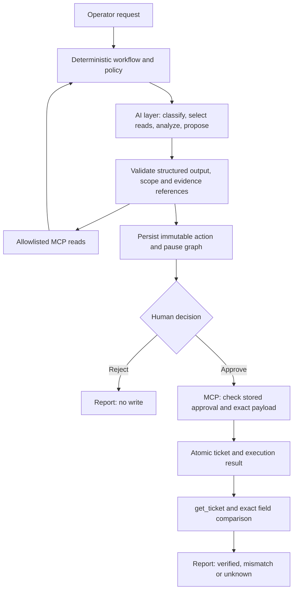

# OpsPilot

**AI proposes; a deterministic core controls execution.**

OpsPilot investigates operational incidents using an AI layer for language understanding,
read-tool selection and evidence-linked hypotheses. An explicit workflow, policy checks,
human approval and transactional MCP execution control whether a proposed action can run.

Portfolio MVP, stages 1–6 implemented: investigation → persisted approval → one verified
internal ticket in a browser workspace. All business data is synthetic; MCP transport, LangGraph execution,
PostgreSQL checkpoints and ticket writes are real. Restart recovery, tracing
and final eval packaging remain stages 7–8. See [implementation status](docs/implementation-status.md).

## Architecture: deterministic core and AI layer

The AI layer returns structured decisions to the core. It cannot grant approval or directly
write a ticket. The core validates each decision before taking the next workflow step.



| Responsibility | AI layer | Deterministic core / human |
| --- | --- | --- |
| Understand the request | Suggest intent, language and customer hint | Reject known forbidden requests; resolve the customer using fixed matching rules |
| Investigate | Select read-tools and arguments inside a bounded loop | Enforce schemas, tool allowlist, customer/integration scope, retries and budgets |
| Interpret evidence | Select supported facts and formulate hypotheses with references | Derive canonical facts from tool data; validate fact equality and evidence references |
| Propose a ticket | Return a structured proposal or abstain; choose an allowed priority | Build canonical customer/title/description/evidence fields and reject changes to them |
| Authorize a write | No approval authority | Human approves/rejects the persisted card; API stores the decision |
| Execute and verify | No model call in execute/verify/report | Read saved arguments, enforce MCP approval/hash checks, write atomically, verify exact fields and render a fixed report |

“Deterministic core” means explicit code controls transitions, permissions and execution
invariants for a given validated input and stored state. It does **not** mean every run
chooses the same tools or reaches the same diagnosis: model outputs, external observations,
IDs, timestamps and transport failures can vary. Evidence-reference validation does not
prove that a model's hypothesis is correct. The hypothesis remains an interpretation;
`actions_verified` confirms the ticket fields, not recovery of the integration.

The boundary is implemented in the current code:

- [AI provider interface](src/opspilot/llm/base.py), [real provider](src/opspilot/llm/real.py)
  and [scripted provider](src/opspilot/llm/scripted.py) share one contract. Scripted mode
  supplies reproducible test decisions while retaining the real workflow, MCP and database.
- [Graph](src/opspilot/agent/graph.py), [policy](src/opspilot/agent/policy.py),
  [evidence rules](src/opspilot/agent/evidence.py) and [budgets](src/opspilot/agent/budgets.py)
  validate and constrain model decisions. The model receives only read-tool contracts.
- [Approval service](src/opspilot/runtime/run_service.py) and
  [immutable actions](src/opspilot/runtime/actions.py) persist human authority outside model output.
- [MCP ticket transaction](src/opspilot/mcp_server/services/tickets.py),
  [executor](src/opspilot/agent/nodes/execute.py) and [verification](src/opspilot/agent/nodes/verify.py)
  enforce the approved write independently of the model.

For a portfolio demo, show the AI's selected reads and hypothesis, inspect the exact saved
card, then compare Reject with Approve. The existing tests demonstrate the core's boundaries:
[model tool restrictions](tests/unit/test_policy.py),
[approval and repeated decisions](tests/integration/test_decisions.py),
[atomicity and concurrent writes](tests/integration/test_ticket_transaction.py), and
[lost responses and verification failures](tests/integration/test_ticket_execution.py).
The current baseline is 120 passing tests; this small synthetic suite is not a production
safety guarantee.

## Initialize the local database

PostgreSQL is a real local Docker database, included in stage 1. The `opspilot` database,
roles and schemas are created when the postgres service initializes its persistent volume.
Alembic creates/updates application tables; seed adds synthetic demo data. Stage 3 adds SDK
checkpoint tables in the separate `checkpoints` schema. No external database is required.

After creating `.env` and filling the database passwords and MCP token as described below:

```powershell
powershell -NoProfile -ExecutionPolicy Bypass -File scripts/setup-local.ps1
```

This builds runtime images, starts PostgreSQL, applies migrations, seeds data, initializes
checkpoints with the restricted checkpoint role and starts API/MCP. It is repeatable and
preserves the volume and unrelated records; seeded demo records are upserted to fixture values.
Use `-SkipBuild` only if images already match the source. No LLM calls are made by setup.
The isolated `opspilot_test` database/volume is created separately by the test scripts.

## Stage 1 quickstart

Prerequisite: Docker Desktop with Linux containers and Docker Compose.

```powershell
Copy-Item .env.example .env
```

Fill every secret in `.env` with a separate random 64-character hex string. For example,
generate each value with `python -c "import secrets; print(secrets.token_hex(32))"`.
Never commit `.env`. Passwords must use hex characters to remain URL-safe.

```powershell
docker compose build
docker compose up -d --wait postgres
docker compose run --rm admin
docker compose run --rm admin python -m opspilot.cli.seed
docker compose run --rm admin python -m opspilot.cli.seed
docker compose up -d mcp api
docker compose exec api python -m opspilot.cli.mcp_smoke
```

Health: http://127.0.0.1:8000/health (200 when database, migrations and MCP are ready).
API uses a restricted workflow role; MCP uses a separate domain role. Neither PostgreSQL
nor MCP publishes a host port. Admin is an explicitly invoked one-shot tools service.
Discovery exposes eight read-tools and the approval-gated `create_ticket` write-tool. No LLM/API key required.

`docker compose down` preserves database data. Init SQL runs only on a new volume;
changing passwords in `.env` does not change credentials in an existing database.
Do not remove database volumes to fix transient startup errors.

## Development

Python 3.12 and uv 0.13.1. `uv sync --frozen`, `uv run ruff check .`, `uv run mypy src`,
`uv run pytest tests/unit`. Integration tests require the isolated stack documented in
docs/implementation-status.md and refuse to run against the regular demo database.

Run the complete stage 1 test suite in an isolated Docker stack:

```powershell
powershell -NoProfile -ExecutionPolicy Bypass -File scripts/test-stage1.ps1
```

The script uses `opspilot-test`, its own volume and `opspilot_test` database, then stops
its containers. It leaves the demo stack and its data intact. Test failures are returned
as a nonzero exit code. Pinned versions and the negotiated MCP protocol are recorded in
[dependencies](docs/dependencies.md).

The authoritative scope and eight implementation stages are in
[OpsPilot_Portfolio_MVP_plan.md](OpsPilot_Portfolio_MVP_plan.md).

## Stage 2 diagnostics

For an existing stage 1 installation, rebuild, apply the new migration and recreate services:

```powershell
docker compose build
docker compose up -d --wait postgres
docker compose run --rm admin
docker compose up -d mcp api
docker compose exec api python -m opspilot.cli.diagnose GreenShop --language ru
docker compose exec api python -m opspilot.cli.diagnose GreenShop --language en
powershell -NoProfile -ExecutionPolicy Bypass -File scripts/test-stage2.ps1
```

The CLI uses real MCP reads without an LLM. JSON includes source references, deterministic
content hashes/evidence IDs, current observations, historical incidents and runbook excerpts.
`Green` returns `insufficient_context` with candidates. Empty search is a successful empty
list; an absent ticket returns `NOT_FOUND`. Diagnostics never create tickets.

Search supports optional `language` (`ru`/`en`), integration type and incident customer
filters; PostgreSQL full-text ranking uses language-specific GIN indexes and stable tie
breaks. Query is 1–500 characters; search/customer limits are 1–10. Event windows are
half-open `[from, to)`, timezone-aware, positive and at most seven days; event limit is 1–100.

Set trusted `SCENARIO_ID` in `.env` to `greenshop_expired` (default), `healthy`, `unknown`,
`timeout` or `contradictory`, then recreate `mcp` and `api` to select an overlay. Tool
arguments cannot select scenarios. Timeout is `MONITORING_TIMEOUT`, with no evidence;
unknown is a successful observation. Contradictory reports preserve healthy status together
with 401 events. Overlays change no database fixtures. Non-GreenShop integrations use
healthy synthetic observations; the timeout overlay makes monitoring unavailable.

The stage 2 script runs all current tests in the same isolated test stack as stage 1.

## Stage 3 investigation

After building/applying migrations as above:

```powershell
docker compose exec api python -m opspilot.cli.run "Investigate why GreenShop orders fail today" --mode scripted
docker compose exec api python -m opspilot.cli.run "Check GreenShop status" --mode scripted
powershell -NoProfile -ExecutionPolicy Bypass -File scripts/test-stage3.ps1
```

This runs a real LangGraph StateGraph with conditional edges and an investigation loop.
PostgreSQL checkpoints are initialized in `checkpoints` before invocation; thread_id=run_id.
CLI output includes mode, model ID, evidence-linked facts/hypotheses, budget counters and
at most one ticket proposal. Since stage 4, actionable investigations pause at approval;
`proposed_only` was the stage-3 checkpoint outcome. No ticket is executed in stage 4.
MCP discovery exposes eight read-tools plus create_ticket; the model only receives read-tools. Runs are stored in `workflow.agent_runs`.

Use `--client-request-id <UUID>` to retrieve an existing identical invocation without
re-running it. Reusing that ID with different request/configuration returns a conflict.
Stage 4 adds API background runs and approval resume; automatic crash recovery remains stage 7.

Scripted mode makes fixture provider decisions, retaining real graph/MCP/database calls.
It supports RU/EN fixture requests, known customer names, `customer <name>`, status-only,
and today relative to the scenario clock in Asia/Jerusalem. Real mode lets the model select
read-tools and arguments; code enforces allowlist/scope/schema checks and budgets.

For real mode add these entries to the local ignored `.env` file:

```dotenv
OPENAI_API_KEY=<your-local-key>
OPENAI_MODEL=gpt-5.6-terra
OPENAI_REASONING_EFFORT=low
LLM_MODE=scripted
```

`OPENAI_MODEL` is an explicit API model ID; no automatic substitution occurs.
Recreate API to load updated values, then invoke real mode explicitly:

```powershell
docker compose up -d --force-recreate api
docker compose exec api python -m opspilot.cli.run "Investigate why GreenShop orders fail today" --mode real
```

The OpenAI Responses REST adapter uses function calling for read selection and strict
structured outputs for classification, analysis and planning. Only API receives the LLM key;
MCP and admin do not. Full provider responses, credentials and hidden reasoning are not logged
or checkpointed. The suite mocks provider HTTP and makes no paid calls.

Limits (recorded per run): rounds=6, read attempts=15 (one reserved for post-write verification,
so at most 14 diagnostic attempts), model attempts=10, measured input+output tokens=30000,
active processing=120 seconds, recursion_limit=60, proposals=1. Configure lower limits with
`AGENT_MAX_ROUNDS`, `AGENT_MAX_READS`, `AGENT_MAX_LLM_ATTEMPTS`, `AGENT_MAX_TOKENS`,
`AGENT_ACTIVE_SECONDS`. Read timeout=5s/max 3 attempts; model timeout=30s/max 2 attempts,
including invalid-output correction. Attempts count even on failure. Known token totals
and unknown_usage_count are separate. Timeouts are capped by remaining active time.
Status-only, missing/ambiguous customers, unknown/timeout/contradictory monitoring and
policy/budget violations cannot produce a ticket proposal.

## Stage 4: durable approval and decisions

Start the updated API/MCP with `scripts/setup-local.ps1`. The API supports one process;
`uvicorn --workers > 1` is unsupported. A PostgreSQL session advisory lock rejects a
second API process before it modifies workflow state. Different runs have separate locks;
one run cannot be invoked/resumed concurrently. Background task failures become failed snapshots.

```powershell
$body = @{ request = 'Investigate GreenShop'; client_request_id = [guid]::NewGuid().ToString() } | ConvertTo-Json
$run = Invoke-RestMethod http://127.0.0.1:8000/api/v1/runs -Method Post -ContentType application/json -Body $body
$snapshot = Invoke-RestMethod ("http://127.0.0.1:8000" + $run.snapshot_url)
# Poll GET until status=waiting_for_approval, then inspect snapshot.action.arguments.
$decision = @{ action_id = $snapshot.action.action_id; decision = 'reject' } | ConvertTo-Json
Invoke-RestMethod ("http://127.0.0.1:8000/api/v1/runs/" + $run.run_id + "/decision") -Method Post -ContentType application/json -Body $decision
```

Use `approve` for the other branch. Reject completes with `rejected` and leaves tickets
unchanged. Since stage 5, Approve creates one ticket and verifies it through get_ticket,
finishing with `actions_verified` only on exact field equality. The saved card remains
visible after either decision. Ticket creation does not repair credentials or restore orders.

POST returns 202 after saving the queued run. Polling reads a public snapshot, without raw
checkpoint data. Reusing client_request_id with identical input returns the same run;
changed input returns 409. Decisions accept only action_id and approve/reject: extra
arguments return 422, missing action/run returns 404, another run's action or an opposite
recorded decision returns 409. A repeated completed decision returns 200, otherwise 202.
The graph pauses with a real persisted interrupt and resumes the original thread using
only the action reference; the approval node independently reads the stored decision.

CLI investigation also pauses at approval:

```powershell
docker compose exec api python -m opspilot.cli.run "Investigate GreenShop" --mode scripted
docker compose exec api python -m opspilot.cli.run --run-id <run_id> --action-id <action_id> --decision reject
powershell -NoProfile -ExecutionPolicy Bypass -File scripts/test-stage4.ps1
```

CLI is a local administrative alternative: avoid invoking it concurrently with API operations
on the same run. Recovery across API crashes and automatic restart handling remain stage 7;
stage 4 supports ordinary pause/resume while the API is running. Never delete checkpoint
or workflow records to retry a decision.

## Stage 5: atomic ticket write and verification

The existing API/CLI approval flow now executes the saved action through MCP. API/graph
never insert a domain ticket directly. MCP locks the action, checks its run/tool, exact
normalized arguments/hash and stored approved decision, then inserts the ticket and saves
execution_result in the same PostgreSQL transaction. No new migration is required: the
stage-1 schema already has the unique action/ticket constraints and restricted role grants.

Repeated create_ticket requests for the same approved action return the original ticket_id
with replayed=true. Payload mismatch is rejected even after a previous successful write.
Concurrent requests create exactly one ticket. create_ticket is excluded from LLM tool
binding and from the graph's diagnostic read dispatcher.

After a lost write response, the executor reads the atomic workflow result and verifies
that ticket via get_ticket. It never creates a replacement action or blindly retries an
uncertain write. With no committed result it reports unknown_outcome. Exact verification
checks customer/title/description/priority/evidence_ids, action/ticket IDs, status and timestamp.
Mismatch gives partial/mismatch; unavailable verification gives unknown_outcome/unknown.
The report includes ticket_id and verification status and leaves order recovery unconfirmed.

```powershell
powershell -NoProfile -ExecutionPolicy Bypass -File scripts/test-stage5.ps1
```

This suite uses the isolated opspilot_test volume and real MCP transport/PostgreSQL. It
checks approval barriers, payload/hash tampering, concurrent writes, transaction rollback,
lost responses, verification mismatch/missing ticket, repeated HTTP Approve and Reject.
Fault injection is a private test function dependency; no fault flags are accepted by API/MCP.
Crash recovery remains stage 7; this stage covers write-response reconciliation in a running API.

## Stage 6: browser workspace

Start the complete local stack with `scripts/setup-local.ps1`, then open
[OpsPilot](http://127.0.0.1:8080). `WEB_PORT` defaults to 8080; if occupied, set
`WEB_PORT=8081` in local `.env` and recreate web. The React UI is served by
nginx and proxies `/api` to FastAPI on the same origin; no CORS wildcard or MCP credential
is exposed to the browser. All published API/web ports bind to loopback.

The request and final report appear on the left; the right shows a live investigation
trail, source observations, AI hypotheses and the exact saved action. AI/Core/Human tags
make the portfolio architecture visible. Model mode is always displayed in the sticky
header: scripted is explicitly labeled, and a saved run's mode overrides current config.

Start a GreenShop investigation, inspect evidence, then Approve or Reject. Evidence links
open local source cards with IDs, observed timestamps and plain text facts. The final
report separates diagnosis, ticket creation, verification and the remaining problem.
Creating a ticket does not repair the integration or establish order recovery.

The URL stores `run_id`; refresh loads that snapshot without creating another run. Polling
uses one active snapshot request, approximately 1 second between reads, backs off to
5 seconds on connection errors and stops on completed/failed runs. Reconnect restores the
server snapshot. A lost create response retries the same client_request_id; a lost decision
response triggers a state read before retry. Buttons never invent an approval locally.

Live progress publication and `GET /api/v1/config` were added to the backend for the UI.
The config endpoint exposes only mode/model, synthetic-data disclosure and scenario clock;
credentials and raw checkpoints stay server-side. Approval becomes actionable only after
the persisted interrupt has completed its checkpoint write.

```powershell
powershell -NoProfile -ExecutionPolicy Bypass -File scripts/test-stage6.ps1
```

The isolated stack runs the Python suite and Playwright against nginx → API → MCP →
PostgreSQL. Browser DB assertions use a read-only domain credential, restricted to the
opspilot_test database; it is passed only to the test runner. UI bundle/environment contains
no DB credentials. Some browser error-state tests deliberately alter HTTP responses; live
Approve/Reject tests use the real services and check ticket counts in PostgreSQL.

For frontend development, with local API running:

```powershell
npm --prefix web ci
npm --prefix web run dev
npm --prefix web run build
```

The dev server binds to 127.0.0.1:5173 and proxies `/api` to 127.0.0.1:8000. Container builds
require no host Node installation. Browser tests are normally run with the isolated Compose
script; direct `npm --prefix web run test:e2e` also requires E2E_BASE_URL and a matching
E2E_DATABASE_URL for opspilot_test. Backend crash recovery is still stage 7; a browser
refresh/reconnect in stage 6 does not imply recovery of arbitrary interrupted graph nodes.

Stage 6 validation: 122 Python tests and 9 Playwright scenarios passed. Desktop and mobile
layouts were inspected. These runs use the scripted provider with real graph/MCP/database
operations; they do not claim a new real-model eval or backend crash-recovery coverage.
