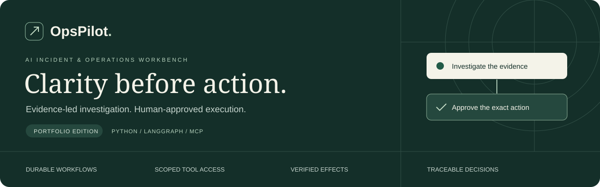
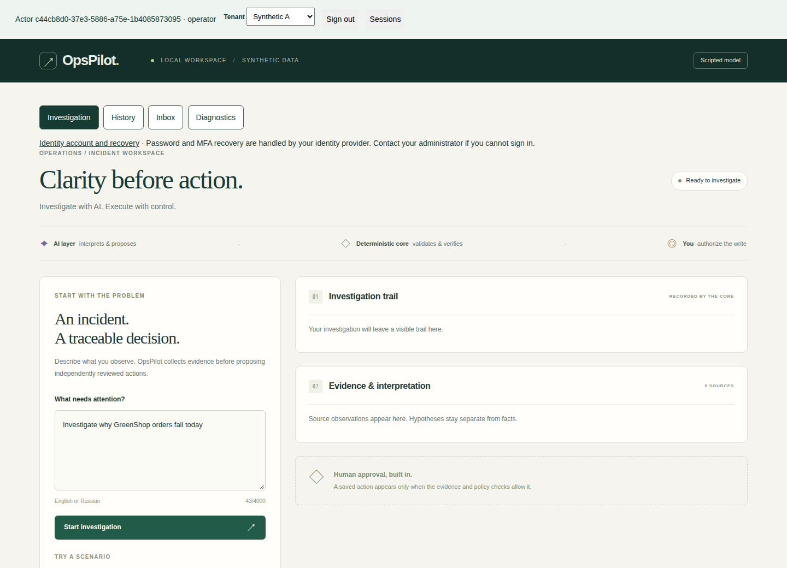
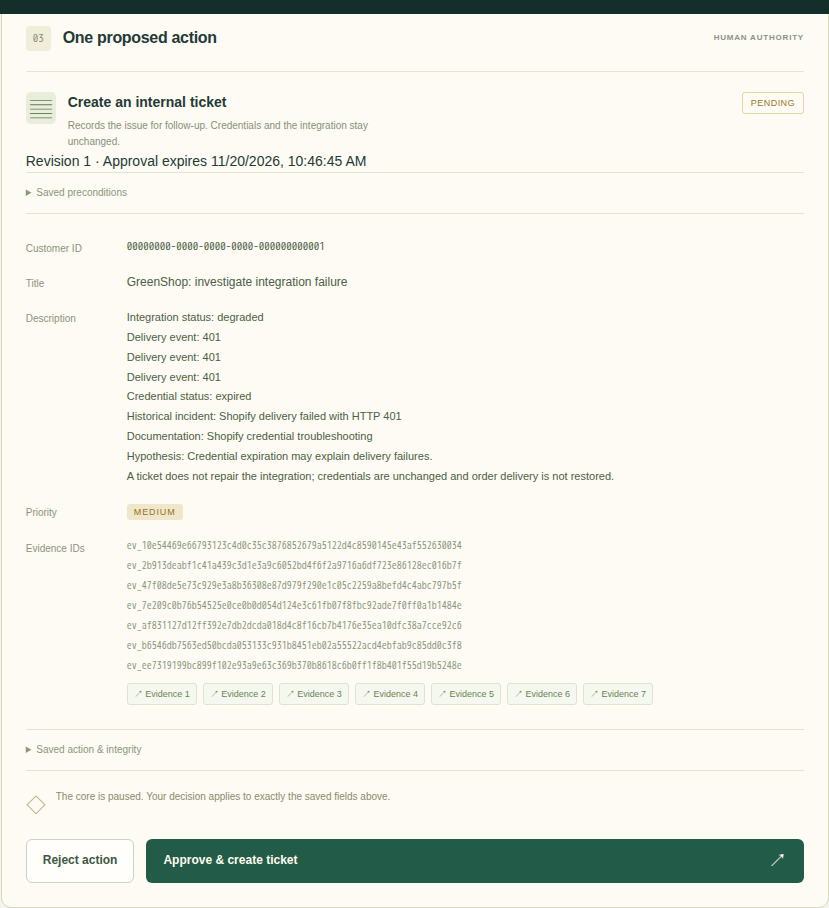
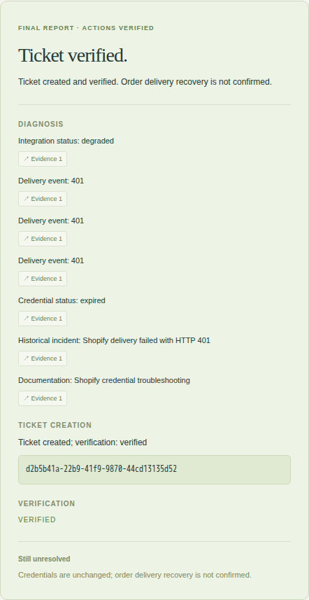
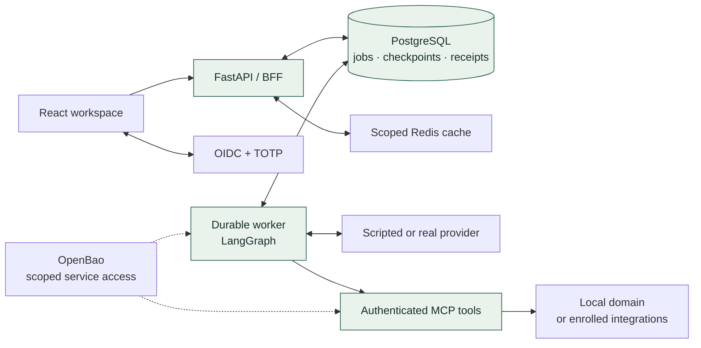

# OpsPilot Full



<p align="center">
  <a href="https://github.com/shibumi2906/opspilot/actions/workflows/f22.yml"></a>
</p>

<p align="center"><strong>An incident investigation workbench with human-controlled, verifiable execution.</strong><br>Python · FastAPI · LangGraph · MCP · PostgreSQL · React / TypeScript</p>

<p align="center"><a href="#see-it-in-action">Demo</a> · <a href="#the-engineering">Engineering</a> · <a href="#measured-results">Results</a> · <a href="#architecture">Architecture</a> · <a href="#explore-and-run">Explore &amp; run</a></p>

**Portfolio edition: complete — 20 November 2026.** OpsPilot demonstrates a working
application, durable agent workflows, approval-bound writes and recovery evidence.
Production rollout and full ASVS L2 acceptance remain a separate, documented scope.
[Completion record](docs/full/portfolio-completion.md)

## From an incident to a verified action

> “Investigate why GreenShop orders fail today.”

OpsPilot collects operational evidence, separates facts from hypotheses, and proposes
a bounded action. An authorized reviewer approves the exact saved payload. The core
checks permissions and freshness, executes through MCP, and verifies the resulting
record before reporting success.

A model proposes the next step; typed contracts, policy, approval and durable receipts
control what the application executes.

## See it in action



*Actual Full interface, captured on 20 November 2026 with synthetic data and the
scripted provider. OIDC/TOTP authentication and the application backend are running.*

<table>
<tr><th>Approve the exact operation</th><th>Inspect the verified result</th></tr>
<tr>
<td width="50%" valign="top"><a href="docs/assets/full/approval.png"></a></td>
<td width="50%" valign="top"><a href="docs/assets/full/verified.png"></a></td>
</tr>
</table>

**The demo flow**

1. Sign in as an operator and select a tenant.
2. Investigate the synthetic GreenShop incident and inspect its linked sources.
3. Review the immutable action card, revision, expiry and evidence.
4. Sign in as a separate approver and authorize the local ticket.
5. Inspect the verified result and reopen the investigation from [history](docs/assets/full/history.png).

The scripted provider makes the demonstration repeatable. PostgreSQL persistence,
worker execution, MCP calls, authorization and the local ticket write use the actual
application. A verified ticket records follow-up work; it does not claim to repair
order delivery.

**Video:** [Watch the narrated MVP walkthrough, 2m 38s](docs/assets/opspilot-demo-narrated.mp4)
· [Silent recording](docs/assets/opspilot-demo.webm)

This preserved video shows the earlier **Portfolio MVP**, including approval, restart
and rejection. The screenshots above show **Full**, which adds tenancy, roles, durable
workers, richer plans, history, audit and integration controls. The English narration
is AI-generated. [Media provenance](docs/demo.md) · [Full guided tour](docs/full/showcase-tour.md)

## The engineering

| Challenge | Implementation | Where to look |
|---|---|---|
| Ground an investigation | Evidence references, explicit hypotheses, contradiction handling and bounded tool selection | [Agent workflow](src/opspilot/agent) |
| Keep approval attached to the effect | Immutable revisions, exact argument hashes, expiry, precondition checks and signed grants | [Grant checks](src/opspilot/security/grants.py) |
| Recover interrupted work | PostgreSQL jobs/checkpoints, leased ownership and fencing against stale workers | [Worker](src/opspilot/runtime/worker.py) · [Checkpoint ADR](docs/full/adr/006-fenced-checkpoint-adapter.md) |
| Isolate tenants and roles | OIDC sessions, server-side permissions, scoped service identities and database row-level security | [Identity](src/opspilot/auth) · [Tenancy ADR](docs/full/adr/004-tenant-isolation.md) |
| Handle uncertain external writes | Durable one-attempt dispatch receipts, independent read-back and operator reconciliation | [Jira runtime](docs/full/evidence/f20/README.md) |
| Make recovery inspectable | Encrypted backups, authenticated retention, isolated restore and table-hash comparison | [Backup operations](docs/full/f23-operational-backups.md) |

### What the workspace supports

- Incident investigation with evidence-linked reports and clarification.
- Tickets, ticket comments and internal inbox notifications.
- Multi-action plans, dependencies, approval waves, revisions, rejection and cancellation.
- Role-aware history, inbox, administration, audit and authenticated SSE updates.
- Scoped Redis caching, admission limits, durable usage accounting and diagnostics.
- Signed observation ingress, Prometheus reads and an enrolled Jira sandbox integration.

The default showcase uses synthetic local integrations. Recorded Jira sandbox checks
are linked as evidence; the screenshot session has no enabled Jira binding.

## Architecture



Workflow state, domain effects and external receipts have explicit ownership.
The browser records decisions through the API; workers resume persisted work.
External operations retain an honest unknown outcome when delivery cannot be
confirmed, and reconciliation reads existing results rather than blindly resending.

## Measured results

Recorded runs have separate environments and denominators; the rows below are not
one combined test count. Baseline measurements are from **16 November 2026**.

| Check | Recorded result | Evidence |
|---|---|---|
| Full scripted evaluation | **50 / 50** | [Verified CI report](docs/full/evidence/f23/operations-20261116/ci-79a856b.json) |
| Preserved MVP scripted regression | **12 / 12** | Same CI, separate suite |
| Backend regression | **603 passed, 71 dedicated-profile skips** | [Fresh regression](docs/full/evidence/f20/README.md) |
| Jira / readiness CI suite | **45 passed**, including native boundary tests | [CI report](docs/full/evidence/f23/operations-20261116/ci-79a856b.json) |
| Backup contract tests | **9 passed** in CI; **37** local backup/OIDC/HTTP tests | [Operational evidence](docs/full/evidence/f23/operations-20261116/README.md) |
| Whole-pilot cold restore | **63.88 s**, **59 table hashes matched** | [Restore scope](docs/full/evidence/f23/local-pilot-20261116/README.md) |
| Runtime image scan | **6 pinned images**, zero HIGH/CRITICAL in that snapshot | [Raw scan gate](docs/full/evidence/f23/local-pilot-20261116/images-r2/gate.json) |

The restore measurement used this local host with preloaded images; it is not a
rebuild-from-scratch or production RTO promise. Scans describe their dated snapshots.

<details>
<summary><strong>Real-model evaluation: original results and diagnostics</strong></summary>

The original real-provider schedule contains **90 recorded runs: 78 passed and
12 failed**, including quota interruptions. Seventeen diagnostic repeats are kept
separately; each of the 12 historical failed records has a successful diagnostic
repeat. The original score and failures are preserved. The holdout was inspected
and is not presented as unseen.

[Original results, diagnostic evidence and owner review](docs/full/evidence/f22/continuation/review-final/README.md)

</details>

## Explore and run

**For a quick review:** start with the screenshots, video and
[guided tour](docs/full/showcase-tour.md). No API key or infrastructure is needed
to inspect the portfolio.

**For a lightweight local check:** install Git, [uv](https://docs.astral.sh/uv/)
and Python 3.12, then run the backup contract suite. These tests use temporary
files and mocked boundaries; they need no Docker, IdP or model key.

```bash
git clone --branch codex/opspilot-full https://github.com/shibumi2906/opspilot.git opspilot-full
cd opspilot-full
uv sync --frozen --python 3.12
uv run --frozen pytest -q tests/unit/test_full_backup.py
```

**For the full reproducible checks:** the [Full CI workflow](.github/workflows/f22.yml)
builds an isolated stack on a GitHub-hosted Linux runner, runs scripted evaluations
and scans public artifacts and images. It needs no LLM or Jira credentials.
On your own fork containing this branch, use **Actions → Full F22 scripted evals → Run workflow**.

**For interactive Full:** the [local operator guide](START-HERE.md) covers the prepared
workspace and preserved TLS pilot. It requires Docker and locally generated private
configuration. This is an operator route, rather than a fresh-clone one-command installer.
The [original MVP](https://github.com/shibumi2906/opspilot/tree/opspilot-portfolio-mvp-v1.0)
remains a separate, preserved edition.

## Scope and boundaries

- **Complete for portfolio presentation and a synthetic local demonstration.**
- Production onboarding/recovery, external TLS, the remaining secret lifecycle and
  host/off-host protection belong to the [production-hardening backlog](docs/security/release-review-20261116/README.md). Full ASVS L2 compliance is not claimed.
- Backups run at 03:00 and 15:00 local host time while the owner session and Docker
  Desktop are available. Archives and keys currently remain on the same host.
- Real-provider execution requires separate credentials and budget authorization.
  The default portfolio walkthrough makes no paid model calls.

## Project map

| Explore | Entry point |
|---|---|
| Portfolio completion and delivery scope | [Completion record](docs/full/portfolio-completion.md) |
| Guided review and demo behavior | [Showcase tour](docs/full/showcase-tour.md) |
| Current system design | [Architecture](docs/full/architecture.md) |
| Implementation history | [Full tracker](docs/full-version-status.md) |
| Original detailed requirements | [Full specification](OpsPilot_Full_Project_Specification.md) |
| Security review and explicit limits | [253-requirement assessment](docs/security/release-review-20261116/README.md) |
| Test, scan and restore records | [Pilot evidence](docs/full/evidence/f23/local-pilot-20261116/README.md) · [Operational checks](docs/full/evidence/f23/operations-20261116/README.md) |

Built to make an operational decision explainable, reviewable and recoverable.
