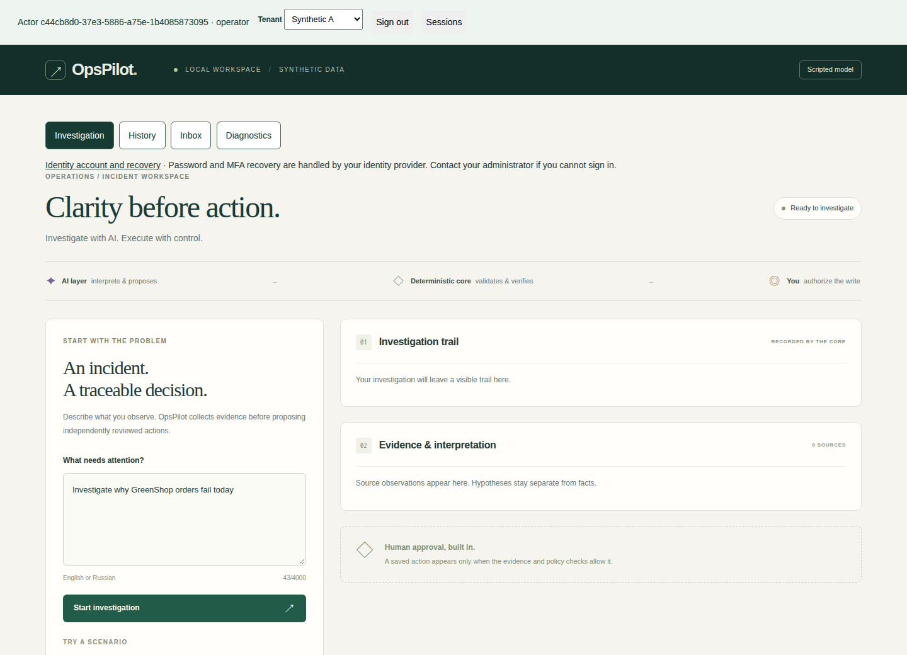
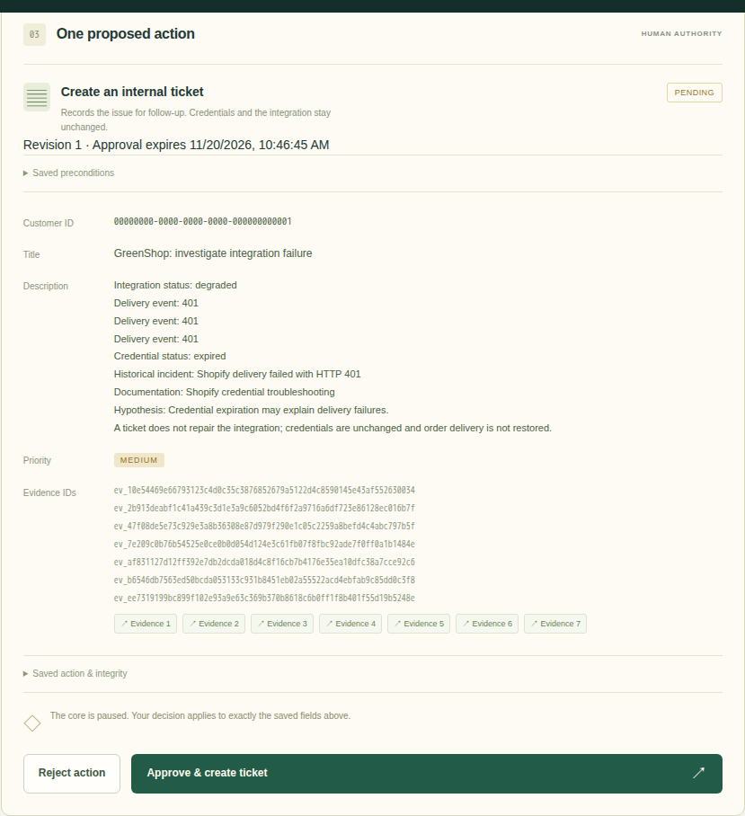
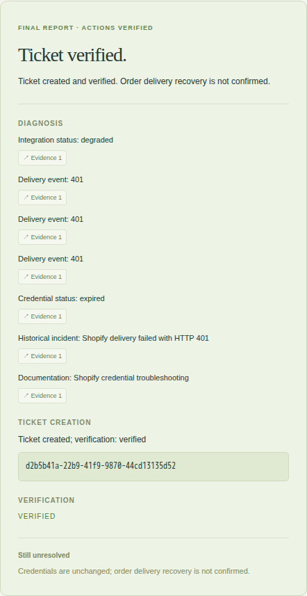
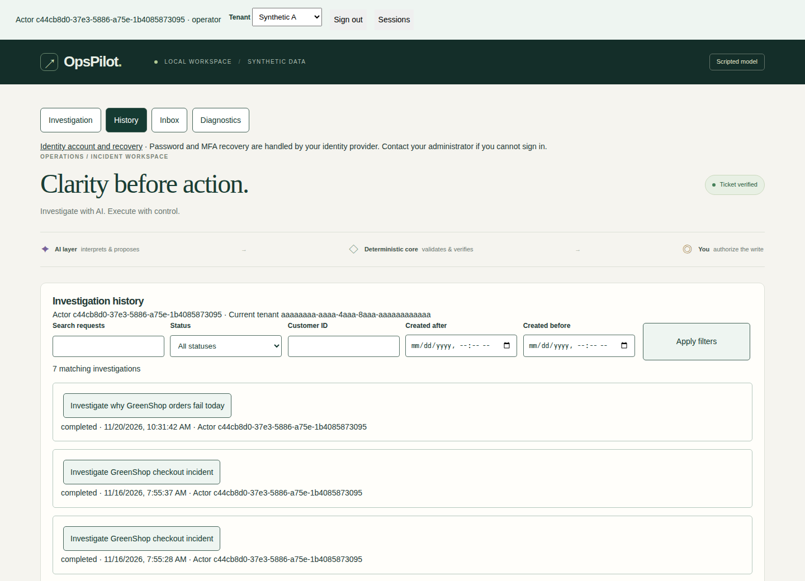

# OpsPilot Full — a five-minute review

This tour is for a recruiter, reviewer or developer exploring the completed portfolio.
Start with the [README](../../README.md). Installation is optional for the first pass.

## 1. Understand the boundary

The user reports an operational incident. A model selects bounded reads and proposes
an action. Core code validates inputs, tenant/actor permissions and freshness. An
authorized human approves an exact saved revision; the worker executes and verifies
the effect through the private MCP tool boundary.

The demonstration is synthetic and scripted. Its database, API, worker, OIDC/TOTP,
MCP transport, approval and local write run as actual application services.

## 2. Follow one investigation

An operator selects Synthetic A and investigates why GreenShop orders fail. The
investigation collects delivery events, integration and credential state, historical
incidents and knowledge articles. Reports link observations and hypotheses to sources.
Contradictory evidence remains visible instead of being silently converted to certainty.

The saved card identifies the operation, customer, payload, revision, expiry and
evidence. The operator cannot authorize their own action in this profile. A separate
approver signs in with MFA and reviews that card before approving the local ticket.
Plans additionally support dependencies, approval waves and partial results.

The result reports the saved ticket and verification status. The remaining business
problem is explicit: creating a ticket does not restore delivery or rotate credentials.

History reopens a persisted run after navigation and new sign-in. The Full workspace
also exposes role-appropriate inbox, diagnostics, audit and administration views.

## 3. Inspect the implementation

| Question | Read next |
|---|---|
| Who owns workflow state and effects? | [Architecture](architecture.md) |
| What prevents stale workers from committing? | [Execution fencing](execution-fencing.md) |
| How do approvals and revisions stay bound? | [Human commands](human-commands.md) · [Grants](../../src/opspilot/security/grants.py) |
| How is tenant access enforced? | [Tenancy](tenancy.md) · [Authorization](authorization.md) |
| What happens after a lost Jira response? | [Jira runtime](f20-jira-runtime.md) |
| Can a saved checkpoint and receipt survive recovery? | [Pilot restore](evidence/f23/local-pilot-20261116/README.md) |
| What remains before production? | [Security assessment](../security/release-review-20261116/README.md) |

## 4. Review evidence

[Verified baseline CI](evidence/f23/operations-20261116/ci-79a856b.json) records
50 Full scripted cases,12 separate MVP cases,45 Jira/readiness checks,12 evaluation
unit cases and9 backup unit cases. These denominators remain separate.

The [backend regression](evidence/f20/README.md) has603 passes and71 dedicated-profile
skips. The [whole-pilot restore](evidence/f23/local-pilot-20261116/README.md) matched59
table hashes in63.88 seconds with preloaded images. Failed earlier attempts remain
available alongside accepted evidence.

The [real-provider results](evidence/f22/continuation/review-final/README.md) preserve
the original78/90 and the separate diagnostic repeats. They are not replaced by the
scripted result. The owner accepted the human review package.

## 5. Run checks or the prepared pilot

A clean clone can run the no-Docker backup contract suite from the README. A fork
containing the Full branch can dispatch the isolated [CI workflow](../../.github/workflows/f22.yml)
without model/Jira credentials. The CI initializer is restricted to ephemeral
GitHub-hosted runners; do not use it as a workstation installer.

For the already prepared local TLS environment, follow [START-HERE](../../START-HERE.md)
and the [operator runbook](f23-operational-backups.md). Local private state is deliberately
not included in Git. Use the existing credentials privately; never put them in README,
screenshots or chat. The fresh showcase images are captured through
[this browser helper](../../scripts/capture-full-showcase.mjs) with two exact leaf pins.

The [2m38 narrated video](../assets/opspilot-demo-narrated.mp4) is the preserved **MVP**
walkthrough, showing approval, API restart and rejection. It illustrates the origin
of the workflow; the Full screenshots and evidence above document the expanded system.
